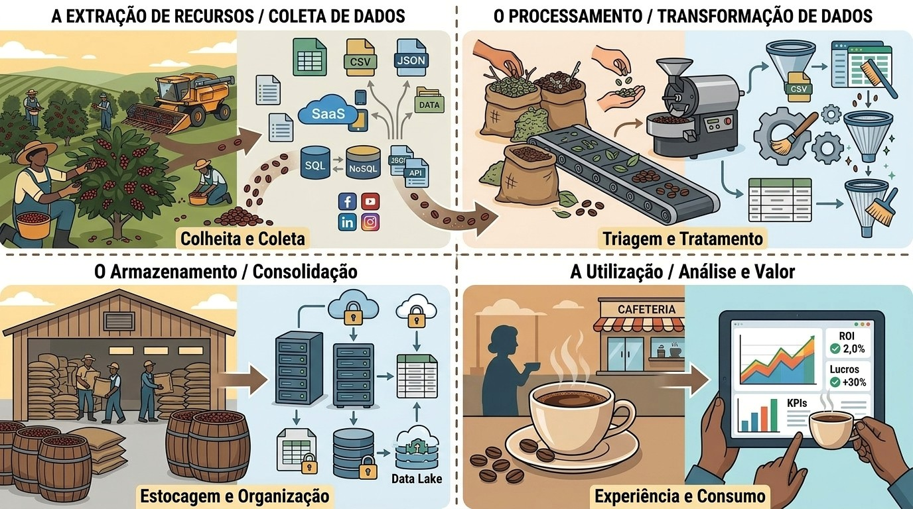

# Guia Prático: Criação de um Simulador de Investimentos

← [Voltar para o README principal](../../readme-simulador.md)

---

Este guia ensina a construir do zero uma planilha para simular investimentos em Fundos Imobiliários (FIIs), aplicando modelagem lógica de dados, fórmulas financeiras e boas práticas de acessibilidade digital.

* **Responsável técnica:** [Camila Santino](https://github.com/camila-santino)
* **Data de atualização:** 24 de nov. de 2026
* **Ferramentas compatíveis:** Google Planilhas e Microsoft Excel

---

## Sumário

1. [Visão e objetivos gerais](#visão-e-objetivos-gerais)
2. [Comparativo: Planilha tradicional vs. Simulador tipo app](#comparativo-planilha-tradicional-vs-simulador-tipo-app)
3. [Exemplos de uso no dia a dia](#exemplos-de-uso-no-dia-a-dia)
4. [Glossário de termos técnicos e conceitos-chave](#glossário-de-termos-técnicos-e-conceitos-chave)
5. [Guia passo a passo de construção (5 etapas)](#guia-passo-a-passo-de-construção-5-etapas)
   * [Passo 1: Design e estruturação da interface (UX/UI)](#passo-1-design-e-estruturação-da-interface-uxui)
   * [Passo 2: Cálculo do patrimônio acumulado e dividendos](#passo-2-cálculo-do-patrimônio-acumulado-e-dividendos)
   * [Passo 3: Projeção de cenários temporais](#passo-3-projeção-de-cenários-temporais)
   * [Passo 4: Implementação de intervalos nomeados](#passo-4-implementação-de-intervalos-nomeados)
   * [Passo 5: Diversificação estruturada por perfil de risco](#passo-5-diversificação-estruturada-por-perfil-de-risco)
6. [Próximos passos](#próximos-passos)
7. [Acessibilidade digital](#acessibilidade-digital)
8. [Referências](#referências)

---

## Visão e objetivos gerais

O objetivo deste projeto é transformar dados financeiros em uma ferramenta simples e fácil de usar. Segundo o consultor Felipe Aguiar, organizar informações de forma estratégica ajuda a tomar decisões melhores. Ele compara os dados brutos ao grão de café colhido, que precisa passar por etapas de preparo antes de ser servido (lógica de ETL):

* **Extração (colheita):** assim como os grãos passam por seleção e lavagem, os dados brutos precisam ser coletados e limpos para remover erros, células vazias e formatos inconsistentes.
* **Transformação (tratamento):** o grão torrado é moído até o ponto certo para liberar seu sabor. Na planilha, os dados são organizados em tabelas estruturadas, categorias e intervalos nomeados.
* **Carregamento (pronto para consumo):** ao passar água quente pelo pó, o café fica pronto. Na planilha, as fórmulas e gráficos entregam indicadores claros para responder às perguntas financeiras.



→ *Quer aprofundar na analogia do café aplicada a ETL? Acesse [Do Grão à Xícara de Café](do-grao-a-xicara-de-cafe.md) ([versão em PDF](../arquivos/Do%20Gr%C3%A3o%20%C3%A0%20X%C3%ADcara%20de%20Caf%C3%A9.pdf)).*

A proposta vai além de usar a planilha como bloco de notas: ela ensina o sentido de cada cálculo. O simulador responde a perguntas reais do dia a dia, como *"Quanto preciso investir por mês para ter R$ 5.000,00 de renda extra em 10 anos?"*.

---

## Comparativo: Planilha tradicional vs. Simulador tipo app

| Aspecto analisado | Planilha comum (tradicional) | Simulador tipo app (profissional) |
| :--- | :--- | :--- |
| **Visual geral** | Grade de linhas padrão visível, gerando sobrecarga visual e dificultando a leitura. | Interface limpa, sem linhas de grade, com blocos bem delimitados. |
| **Organização** | Células e fórmulas expostas sem hierarquia visual, misturando entradas e resultados. | Separação clara entre entradas (campos dimensionais) e resultados (campos fato). |
| **Foco estratégico** | Ausência de ordem de leitura ou direcionamento para tomada de decisão. | Estrutura guiada para responder a perguntas de negócio reais. |
| **Fórmulas legíveis** | Coordenadas genéricas (ex.: `=C5*(1+B12)`). | Fórmulas semânticas com intervalos nomeados (ex.: `=salario_mensal*0,30`), facilitando leitura e auditoria. |
| **Segurança e interação** | Risco de apagar fórmulas por acidente por falta de sinalização e proteção. | Menus suspensos (validação de dados), sinalização textual/visual e células calculadas protegidas. |

---

## Exemplos de uso no dia a dia

Considerando aportes feitos ao final de cada mês (`fim_ou_inicio = 0`), sem capital inicial e com taxa anual de 10% ao ano (equivalente composta de **0,7974% ao mês**):

* **Planejamento de renda extra:** aplicando **R$ 486,30 por mês** (30% de um salário mínimo de R$ 1.621,00) durante **10 anos** (120 meses), a pessoa usuária acumula aproximadamente **R$ 97.193,79**, gerando uma renda passiva mensal estimada de **R$ 775,04** ao final do período.
* **Efeito bola de neve no longo prazo:** com o aporte mensal de **R$ 486,30**, os dividendos já superam o próprio aporte no **88º mês** (7 anos e 4 meses: patrimônio de **R$ 61.693,39** e dividendos de **R$ 491,95**). Ao final do **8º ano** (96 meses), o patrimônio acumulado chega a **R$ 69.741,34** e os rendimentos mensais estimados alcançam **R$ 556,13**, acelerando o crescimento do capital.
* **Reajuste do salário mínimo:** o cálculo acima considera um aporte fixo de **R$ 486,30**. Se você acompanhar os reajustes anuais do salário mínimo mantendo sempre a regra de investir 30%, o patrimônio final e a renda extra serão maiores.

---

## Glossário de termos técnicos e conceitos-chave

Antes de montar a planilha, vale diferenciar valores de entrada e categorização (**Campos Dimensionais**) de valores calculados (**Campos Fato**):

| Conceito / Função | Definição simplificada | Exemplo prático no simulador |
| :--- | :--- | :--- |
| **VF (Valor Futuro)** | Função financeira que calcula o total acumulado de um investimento com juros compostos. | **Campo Fato:** calcula o patrimônio acumulado em 2, 5, 10, 20 e 30 anos. |
| **PROCV** | Função de busca vertical que encontra um valor na primeira coluna de uma tabela e traz um dado correspondente. | Busca o percentual de cada categoria de FII na tabela de apoio conforme o perfil escolhido. |
| **Chave Composta** | Junção de dois ou mais critérios com o operador `&` (`=Perfil & "-" & Tipo_FII`) para criar um código único de pesquisa. | Une `"Arrojado"` e `"Shoppings"` em `"Arrojado-Shoppings"` para o `PROCV` encontrar a linha exata. |
| **Intervalos Nomeados** | Apelido legível atribuído a uma célula ou intervalo (ex.: `salario_mensal`). | Permite escrever `=salario_mensal*0,30` em vez de `=B12*0,30`. |
| **Validação de Dados** | Recurso que restringe o que pode ser digitado em uma célula, criando um menu suspenso. | **Campo Dimensional:** cria a lista para escolher entre `Conservador`, `Moderado` ou `Arrojado`. |
| **Aporte** | Quantia investida regularmente todo mês para acelerar o crescimento do patrimônio. | Valor mensal utilizado como pagamento periódico na função `VF`. |
| **Dividendos** | Renda passiva distribuída mensalmente pelos FIIs aos cotistas. | **Campo Fato:** multiplica o patrimônio acumulado pela taxa mensal equivalente. |
| **FIIs (Fundos Imobiliários)** | Investimento coletivo aplicado em imóveis físicos ou títulos do setor imobiliário. | Base da simulação, dividida em Logística, Papel, Tijolo, Shoppings, FOFs e Outros. |
| **Tabela de Apoio** | Aba secundária usada para guardar regras fixas e percentuais de distribuição. | Aba `Perfis e Porcentagens`, separada do painel principal para manter o modelo limpo. |
| **Referências Absolutas (`$` / `F4`)** | Fixação do endereço de uma célula para que ele não mude ao arrastar uma fórmula. | Trava a célula da taxa de juros (`$B$4`) ao copiar a fórmula para diferentes anos. |

---

## Guia passo a passo de construção (5 etapas)

### Passo 1: Design e estruturação da interface (UX/UI)

1. **Limpeza visual:** no menu superior, acesse **Ver > Mostrar** (Google Planilhas) ou **Exibir** (Excel) e desmarque **Linhas de grade**.
   * *Particularidades de cada plataforma:* no **Google Planilhas** não há opção de ocultar os títulos de linhas e colunas; já no **Excel para Web**, não é possível excluir permanentemente as linhas e colunas sobressalentes além da área útil (por isso adota-se `"n/a"` como apoio de navegação quando necessário).
2. **Cabeçalho e hierarquia:** crie um título claro no topo da planilha com fundo escuro de alto contraste (ex.: azul-marinho ou verde escuro) e texto branco em fonte sem serifa (Arial, Roboto ou Verdana), negrito e tamanho legível.
   * **Nota de acessibilidade:** embora muitos tutoriais recomendem mesclar células (`A1:H3`) para criar um banner, evite células mescladas em qualquer área de dados ou navegação. Ajuste largura de colunas e altura de linhas para manter o visual limpo sem travar leitores de tela.
3. **Padronização semântica de cores e rótulos:**
   * **Campos para preencher (entradas):** use fundo claro suave com bordas nítidas e rótulo explícito indicando o que digitar (ex.: *Renda mensal*, *Prazo em anos*, *Taxa anual*).
   * **Campos calculados (resultados):** use fundo cinza claro com texto escuro em negrito para indicar que contêm fórmulas automáticas. Ative a proteção em **Dados > Proteger páginas e intervalos** (Google Planilhas) ou **Revisão > Proteger planilha** (Excel), deixando apenas as células de entrada liberadas.
4. **Organização em blocos:** estruture a aba principal de forma vertical (leitura linear de cima para baixo) em três blocos: *Alocação por perfil*, *Dados do investidor* e *Estimativas do investimento*.
5. **Tabelas estruturadas:** converta os blocos em tabelas nativas (**Formatar > Converter em tabela** no Google Planilhas ou `Ctrl + T` no Excel) para garantir cabeçalhos semânticos e expansão automática.

---

### Passo 2: Cálculo do patrimônio acumulado e dividendos

As fórmulas dependem de variáveis para fazer os cálculos que, geralmente, estão localizadas em outras células da planilha. Os cálculos ficam visíveis em células dedicadas para facilitar a auditoria. A base da projeção é a função financeira **Valor Futuro (`VF`)**:

```excel
=VF(taxa; numero_de_periodos; valor_do_pagamento; [valor_presente]; [fim_ou_inicio])
```

* **`taxa`:** taxa de juros mensal.
  * *Forma simplificada (nominal):* dividir a taxa anual por 12 (`=Taxa_Anual / 12`).
  * *Forma exata (juros compostos — adotada nas versões V3.1):* usar a fórmula de taxa mensal equivalente `=(1 + taxa_anual)^(1/12) - 1`. Na versão **Google Planilhas V3.1**, ela é encapsulada em uma **Função Nomeada** chamada `TAXAMENSAL(taxa_anual)`; nas versões **Microsoft Excel para Web (`.xlsx`)** e **LibreOffice Calc (`.ods`)**, usa-se a fórmula composta direta protegida por `SEERRO`: `=SEERRO((1 + taxa_anual)^(1/12) - 1; 0)`. Em todas, 10% a.a. equivale a 0,7974% a.m. (e não 0,8333% a.m.).
* **`numero_de_periodos`:** total de meses do investimento (`=Anos * 12`).
* **`valor_do_pagamento`:** valor aplicado todo mês (`Aporte_Mensal`).
* **`valor_presente`:** capital inicial já guardado (`Capital_Inicial`). **Importante:** deve ter o **mesmo sinal** que `valor_do_pagamento` para que ambos sejam somados como investimentos no mesmo sentido.
* **`fim_ou_inicio`:** opcional; `0` (padrão) indica aportes feitos ao final de cada mês.

#### Fórmula do patrimônio acumulado

```excel
=-VF(Taxa_Mensal; Anos_Investimento * 12; Aporte_Mensal; Capital_Inicial; 0)
```

*(Alternativa equivalente, sem o menos na frente: `=VF(Taxa_Mensal; Anos_Investimento * 12; -Aporte_Mensal; -Capital_Inicial; 0)`.)*

> [!NOTE]
> **Saiba mais — Convenção de fluxo de caixa e sinais na função `VF`**
>
> Na contabilidade e nas funções financeiras, entradas e saídas de dinheiro usam sinais opostos:
>
> * **Saídas de caixa (sinal negativo `-`):** investimentos iniciais (CAPEX), aportes periódicos, pagamentos a fornecedores, despesas, impostos e amortizações.
> * **Entradas de caixa (sinal positivo `+`):** recebimentos de vendas à vista ou a prazo, rendimentos financeiros e aportes de capital recebidos.
>
> **Como isso funciona na fórmula `VF` da planilha:**
>
> * **Sinais idênticos somam:** tanto o aporte mensal (`valor_do_pagamento`) quanto o capital inicial (`valor_presente`) representam dinheiro saindo do bolso para o investimento. Eles precisam ter o **mesmo sinal** (ambos positivos dentro de `=-VF(...)` ou ambos negativos dentro de `=VF(...)`). Se tiverem sinais trocados (ex.: aporte positivo e capital inicial negativo), a função **subtrai** o capital inicial do total acumulado.
> * **Inversão do resultado:** quando ambos os argumentos entram positivos, a função `VF` retorna um número negativo. Colocar o sinal de menos antes da função (`=-VF(...)`) serve apenas para exibir o patrimônio final como número positivo.

#### Fórmula dos dividendos mensais estimados

```excel
=Patrimonio_Acumulado * Taxa_Mensal
```

---

### Passo 3: Projeção de cenários temporais

Crie uma segunda aba (`Painel de evolução do investimento` no Google Planilhas / `Simulador de Rendimento` no Excel para Web, respeitando o limite de 31 caracteres de nome de aba no Excel) para comparar prazos de curto, médio e longo prazo. Ao arrastar fórmulas para várias linhas:

* **Referência relativa (ex.: `A2`):** não usa `$`. Ao arrastar para baixo, atualiza automaticamente (`A2`, `A3`, `A4`), lendo o número de anos de cada linha.
* **Referência absoluta (ex.: `$B$4`):** usa `$` (atalho `F4`) para travar linha e coluna, mantendo a fórmula apontando sempre para as células de taxa, aporte e capital inicial.

#### Exemplo de tabela de prazos

Considerando taxa mensal equivalente de **0,7974% a.m.** (10% a.a.) em `$B$4`, aporte mensal de **R$ 1.000,00** em `$B$5` e capital inicial de **R$ 5.000,00** em `$B$6`:

| Célula prazo | Anos | Prazo em meses | Fórmula do patrimônio acumulado (`VF`) | Patrimônio estimado | Dividendos mensais |
| :--- | :---: | :---: | :--- | :---: | :---: |
| `A2` | 2 | `=A2*12` | `=-VF($B$4; B2; $B$5; $B$6; 0)` | R$ 32.385,13 | R$ 258,24 |
| `A3` | 5 | `=A3*12` | `=-VF($B$4; B3; $B$5; $B$6; 0)` | R$ 84.613,78 | R$ 674,72 |
| `A4` | 10 | `=A4*12` | `=-VF($B$4; B4; $B$5; $B$6; 0)` | R$ 212.832,57 | R$ 1.697,16 |
| `A5` | 20 | `=A5*12` | `=-VF($B$4; B5; $B$5; $B$6; 0)` | R$ 751.896,73 | R$ 5.995,73 |
| `A6` | 30 | `=A6*12` | `=-VF($B$4; B6; $B$5; $B$6; 0)` | R$ 2.150.090,33 | R$ 17.145,12 |

---

### Passo 4: Implementação de intervalos nomeados

Substituir coordenadas como `$B$4` por nomes descritivos facilita a leitura, reduz erros ao arrastar fórmulas e melhora a auditabilidade. No Google Planilhas, acesse **Dados > Intervalos nomeados**; no Excel, use `Ctrl + F3` ou **Fórmulas > Definir Nome**.

Exemplos de nomes usados no simulador:

* `perfil_user` (`$C$1`) — perfil de investidor selecionado na lista suspensa;
* `salario_mensal` — renda mensal informada;
* `sugestao_aporte` — `=SEERRO(salario_mensal * 0,30; 0)`;
* `aporte_user` — aporte mensal opcional digitado pela pessoa usuária;
* `capital_inicial` — valor já guardado;
* `taxa_anual` e `taxa_mensal` — taxas anual e mensal equivalente;
* `prazo_ano_user` e `prazo_mes_user` — prazos em anos e meses;
* `valor_mensal` — estimativa de dividendos mensais.

| Sintaxe convencional | Com intervalos nomeados |
| :--- | :--- |
| `=-VF($B$4; B2; $B$5; $B$6; 0)` | `=SEERRO(-VF(taxa_mensal; prazo_mes_user; sugestao_aporte; capital_inicial; 0); 0)` |

**Evolução adotada na V3.1:** para permitir que a pessoa usuária digite um aporte personalizado ou deixe em branco para usar os 30% do salário — sem gerar erros em cascata caso alguma entrada esteja zerada — combine `SEERRO`, `SE` e `ÉCÉL.VAZIA`:

```excel
=SEERRO(-VF(taxa_mensal; prazo_mes_user; SE(ÉCÉL.VAZIA(aporte_user); sugestao_aporte; aporte_user); capital_inicial; 0); 0)
```

---

### Passo 5: Diversificação estruturada por perfil de risco

Para dividir o valor investido entre as 6 categorias de FIIs conforme o perfil escolhido:

1. **Validação de dados (lista suspensa):** na aba principal, selecione a célula de perfil (`perfil_user` em `$C$1`), acesse **Dados > Validação de dados** e configure uma lista obrigatória (`allowBlank = falso`) com os valores `Conservador`, `Moderado` e `Arrojado`. *(Nota da criadora: para saber mais sobre os perfis de investidor, consulte a seção [Escolha seu perfil de investidor](tutorial-simulador.md#1-escolha-seu-perfil-de-investidor-simulador-de-investimentos) no Tutorial do Simulador.)*
2. **Tabela de apoio (`Perfis e Porcentagens`):** em uma aba separada, monte uma tabela de 4 colunas (`Perfil de risco`, `Perfil do Investidor`, `Tipo de FII`, `Alocação do aporte (%)`) com 18 linhas (3 perfis × 6 categorias), garantindo que cada perfil some exatamente **100%**.
   Na primeira coluna, gere a chave composta concatenando perfil e categoria com `&`:
   ```excel
   =B2 & "-" & C2
   ```
3. **Busca dinâmica com `PROCV`:** de volta ao painel principal, busque o percentual correspondente à combinação atual usando `perfil_user`:
   ```excel
   # Versão Google Planilhas (usando tabela estruturada):
   =SEERRO(PROCV((perfil_user & "-" & A3); T5_Perfis_de_risco_e_percentagens; 4; FALSO); 0)

   # Versão Microsoft Excel para Web (.xlsx) e LibreOffice (.ods):
   =SEERRO(PROCV((perfil_user & "-" & A3); 'Perfis e Porcentagens'!$A$2:$D$19; 4; FALSO); 0)
   ```
4. **Valor em reais por categoria:** multiplique o percentual retornado pelo aporte efetivo (usa `aporte_user` se preenchido ou `sugestao_aporte` caso esteja em branco):
   ```excel
   =SEERRO(SE(ÉCÉL.VAZIA(aporte_user); sugestao_aporte; aporte_user) * B3; 0)
   ```

#### Exemplo prático — Alocação no perfil Conservador

Considerando perfil **Conservador** e aporte mensal de **R$ 300,00** (30% de um salário de R$ 1.000,00):

| Tipo de FII | Alocação (%) | Valor alocado no mês |
| :--- | :---: | :---: |
| **Logística** | 25% | R$ 75,00 |
| **Papel** | 40% | R$ 120,00 |
| **Tijolo** | 20% | R$ 60,00 |
| **Shoppings** | 10% | R$ 30,00 |
| **FOFs** | 5% | R$ 15,00 |
| **Outros** | 0% | R$ 0,00 |
| **Total** | **100%** | **R$ 300,00** |

---

## Próximos passos

Depois de concluir a estrutura base, você pode expandir a planilha com:

* **Gráfico de pizza dinâmico:** ligado à tabela de alocação por FII, atualizando as fatias sempre que o perfil mudar.
* **Linha de simulação personalizada e boas práticas de visualização:** um campo editável extra no painel temporal para testar qualquer prazo fora dos marcos fixos de 2 a 30 anos. *Nota técnica:* como o patrimônio segue uma função financeira determinística exata (`VF`), evite adicionar linhas de tendência estatística (linear ou exponencial <span lang="en">OLS</span>) sobre as colunas — a regressão linear pode gerar previsões negativas nos primeiros anos e a exponencial simples superestima o horizonte de 30 anos por não passar pela origem $(0, 0)$.
* **Ocultar barra de fórmulas, títulos e guias (modo tela cheia):** apresentar a interface limpa como aplicativo na versão final (**Ver > Tela inteira** no Google Planilhas ou `Ctrl + F1` / configurações de exibição no Excel).
* **Reaproveitamento da arquitetura:** adaptar a mesma combinação (`VF` + `PROCV` + intervalos nomeados) para metas como reserva de emergência, planejamento do dinheiro das férias ou aposentadoria.

---

## Acessibilidade digital

Para que a planilha funcione bem para todas as pessoas — incluindo quem usa teclado ou leitores de tela —, aplique estas diretrizes desde o início (alinhadas à ABNT NBR 17225:2025, ABNT NBR ISO 24495-1 e WCAG 2.1/2.2):

* **Tipografia legível:** priorize fontes sem serifa projetadas para alta legibilidade (como `Lexend Deca` / `Lexend`, adotadas nas planilhas deste projeto, ou `Arial`, `Verdana` e `Roboto`) com boa diferenciação entre caracteres como `I`, `l` e `1`.
* **Contraste e sinalização não exclusiva por cor:** mantenha relação de contraste mínima de 4,5:1 entre texto e fundo e nunca use apenas cor para indicar um campo — acompanhe sempre com rótulo textual claro.
* **Sem células mescladas e leitura linear:** organize blocos de cima para baixo e da esquerda para a direita para que a navegação por teclado (`Tab` e setas) seja previsível.
* **Suporte a tecnologias assistivas:** use tabelas estruturadas nativas, formatos numéricos explícitos (moeda, percentual, inteiro), textos alternativos nos gráficos e um glossário documentando variáveis e localizações.

---

## Referências

* Microsoft. [Funções financeiras (referência)](https://support.microsoft.com/pt-br/excel/financial-functions-reference). Acesso em: 16 nov. 2026.
* Hewlett-Packard Company. [HP-12C Owner’s Handbook and Problem-Solving Guide](https://literature.hpcalc.org/community/hp12c-oh-en.pdf). 2ª ed., 1982. Acesso em: 16 nov. 2026.

---

← [Voltar para o README principal](../../readme-simulador.md) | [Do Grão à Xícara de Café](do-grao-a-xicara-de-cafe.md) | [Próximo: Tutorial de Uso →](tutorial-simulador.md)
