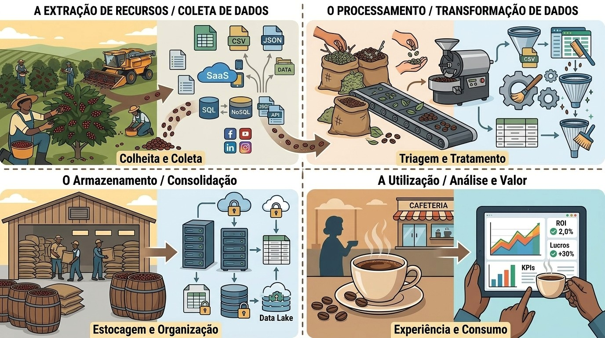

← [Voltar para o README principal](../../readme-simulador.md) | [Guia Prático de Criação](construcao-simulador.md)

# Do Grão à Xícara de Café[^1]

*Entendendo o Fluxo de Dados e o Processo de ETL*

[Camila Santino](mailto:camila_santino@hotmail.com) · 17 de nov. de 2026  
**Objetivo:** Compreender o que é o processo de ETL e como dados brutos são transformados em informações úteis para a tomada de decisão.

---

## Introdução

### Por que não usar os dados direto da fonte?

No dia a dia, as empresas geram milhares de informações em planilhas, aplicativos, sistemas de vendas e redes sociais. Porém, esses dados nascem desorganizados, com erros de digitação, informações repetidas e formatos diferentes.  
Para compreender como dados brutos se transformam em decisões estratégicas, podemos observar o caminho percorrido pelo café, desde a lavoura até o consumo. Na área de dados, esse percurso é conhecido como *Pipeline* de Dados, e sua espinha dorsal é o processo de **ETL**. A sigla vem do inglês *Extract, Transform, Load* que, traduzido para o português brasileiro, quer dizer: **Extrair, Transformar e Carregar**.

### Visão Geral do Fluxo

Imagine que o seu objetivo final seja servir uma xícara de café perfeita (que representa o *insight* de negócios, o relatório ou o modelo de Inteligência Artificial). Para chegar até ela, você precisa passar pelas seguintes etapas:

| Etapa do Café | Etapa Técnica (Dados) | Objetivo Principal |
| :--- | :--- | :--- |
| Colheita e Recebimento | *Extract* (Extração) | Coletar dados brutos de diversas origens. |
| Beneficiamento, Torra e Moagem | *Transform* (Transformação) | Limpar, padronizar e estruturar os dados. |
| Armazenamento e Infusão | *Load* (Carregar) | Disponibilizar os dados prontos em um repositório central. |
| Degustação e Análise Sensorial | BI (Análise de Dados) | Entender o comportamento atual e histórico. |
| Criação de Novas Receitas | Ciência de Dados / IA | Prever cenários futuros e otimizar resultados. |

---

## O caminho do café e a Pipeline de dados

### E — Extract (Extração) — a colheita

Na produção do café, os grãos estão espalhados por diferentes fazendas. Eles vêm em sacas contendo diversos tipos (arábica, robusta) e misturados com folhas, galhos e terra. Com dados, acontece algo semelhante: as empresas geram milhares de informações em planilhas, aplicativos, sistemas de vendas ou redes sociais. No entanto, esses dados nascem desorganizados, com erros de digitação, informações repetidas ou formatos diferentes. O profissional, então, busca os dados brutos onde eles estiverem e os reúne em uma área de armazenamento inicial (*Data Lake* ou *Staging Area*).

### T — Transform (Transformação) — a limpeza

Você não joga os grãos sujos e inteiros direto na água quente. Grãos crus e com impurezas não produzem uma boa bebida. Primeiro, você remove as impurezas, joga fora os grãos estragados, torra e mói na espessura correta para o tipo de café que quer fazer.  
Nos dados, o **T** é a etapa de limpeza e organização. Dados brutos vêm desorganizados, o que comprometeria qualquer análise. Aqui, apagamos linhas duplicadas, corrigimos valores errados, preenchemos campos vazios e padronizamos tudo para que os dados façam sentido juntos.

### L — Load (Carregar) — o preparo

Agora que o pó de café está pronto, ele precisa ser passado pela água quente, resultando em uma bebida limpa e pronta para o consumo.  
Com os dados já limpos e estruturados, o profissional salva tudo em um banco de dados organizado, onde ficam seguros e prontos para serem consultados. Geralmente, usa-se um *Data Warehouse*.

---

### O consumo — a extensão do ETL

Com o café pronto na xícara, entram em cena os profissionais responsáveis por gerar valor a partir da bebida. Eles podem ser:

* **Analista de Dados (BI):** é o degustador. Ele olha para o café pronto para entender o que já aconteceu. Ele cria e analisa gráficos e relatórios para responder a perguntas como: *"Quantos cafés vendemos ontem? Qual sabor fez mais sucesso? Onde o consumo foi maior?"*.
* **Cientista de Dados:** é o criador de receitas. Ele estuda os ingredientes e usa matemática e Inteligência Artificial — como temperatura da água, tempo de extração e tipo de grão — para prever o futuro: *"Se mudarmos a temperatura da água amanhã, quantos cafés a mais vamos vender?"*.

A qualidade dessa análise final depende diretamente da preparação inicial. Se o processo de ETL falhar em alguma etapa, os modelos de Inteligência Artificial e os relatórios gerenciais trabalharão com informações comprometidas — o equivalente a servir uma bebida preparada com grãos sujos e cheios de terra.

---

## Síntese Didática

**Regra de Ouro:** Se a etapa de Transformação (limpeza) for mal feita, o café ficará amargo. Em dados, chamamos isso de *"lixo entra, lixo sai"*: dados sujos sempre geram gráficos e previsões erradas.

### Quadro-Resumo de Consulta Rápida

| Sigla | Tradução | Analogia do Café | O que acontece na prática? |
| :--- | :--- | :--- | :--- |
| **E** | Extração | Colher o grão | Coletar dados brutos de várias fontes. |
| **T** | Transformação | Limpar, torrar e moer | Corrigir erros e padronizar formatos. |
| **L** | Carga | Servir na xícara | Salvar os dados limpos no destino final. |

---

## Exercício de Fixação

Associe as ações abaixo à etapa correta do ETL (`[ E ]` Extração, `[ T ]` Transformação ou `[ L ]` Carga):

1. `( )` Apagar nomes de clientes que foram cadastrados duas vezes na planilha.
2. `( )` Baixar os arquivos de vendas do sistema da loja e do aplicativo de entregas.
3. `( )` Salvar a tabela final já corrigida no sistema onde os diretores acessam os gráficos.
4. `( )` Padronizar todas as datas de nascimento para o formato `DD/MM/AAAA`.

*(Gabarito: 1-T | 2-E | 3-L | 4-T)*

---

📄 [Baixar este material em PDF](../arquivos/Do%20Gr%C3%A3o%20%C3%A0%20X%C3%ADcara%20de%20Caf%C3%A9.pdf)

← [Voltar para o README principal](../../readme-simulador.md) | [Ir para o Guia Prático de Criação →](construcao-simulador.md)

[^1]: Elaborado por Camila Santino, em novembro de 2026, com recursos de inteligência artificial do ecossistema Gemini. Para mais informações, [vá para meu perfil no GitHub](https://github.com/camila-santino).
