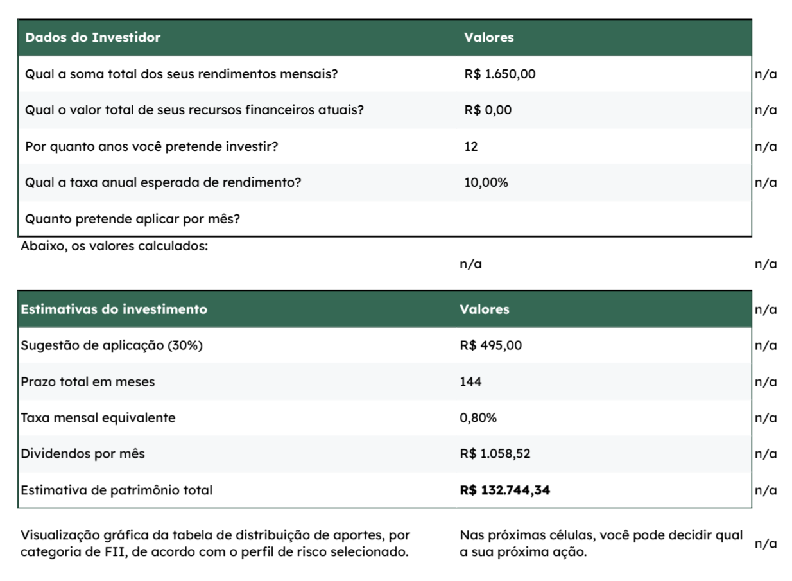
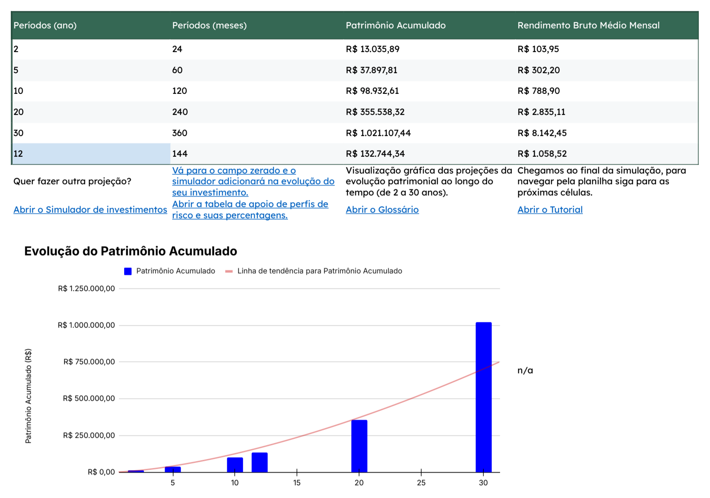

# Simulador de Investimentos — Tutorial de Uso e Demonstração

← [Voltar para o README principal](../../readme-simulador.md)

---

Este tutorial mostra como usar a planilha pronta passo a passo. Você não precisa ter experiência prévia com finanças, fórmulas ou mercado financeiro: basta informar seus dados nos campos editáveis para visualizar a divisão por perfil, as estimativas de patrimônio e os gráficos atualizados automaticamente.

---

## Antes de começar

1. **Escolha sua versão:** na seção [Materiais e links](../../readme-simulador.md#materiais-e-links) do README, escolha entre usar no **Google Planilhas** (navegador) ou baixar o arquivo **.xlsx** / **.ods** para o **Microsoft Excel** ou LibreOffice.
2. **Faça a sua própria cópia:**
   * **No Google Planilhas:** abra o link e clique em *Arquivo > Fazer uma cópia* para salvar uma versão privada no seu Drive.
   * **No Excel ou LibreOffice:** baixe o arquivo `.xlsx` ou `.ods` para o seu computador (ou salve uma cópia privada na nuvem). As planilhas já abrem pré-preenchidas com um cenário ilustrativo (`R$ 1.650,00`, `12` anos, `10,00% a.a.`) para facilitar a visualização imediata — basta sobrescrever os campos editáveis com os seus dados.
3. **Tenha estes dados em mãos:**
   * **Renda mensal líquida:** soma do que você recebe por mês após descontos (salário, pró-labore, aposentadoria, aluguéis ou outras rendas recorrentes).
   * **Recurso inicial:** valor que você já tem guardado para começar (pode ser `R$ 0,00`).
   * **Prazo desejado:** por quantos anos pretende manter o investimento.
   * **Taxa anual esperada:** rendimento estimado por ano (normalmente entre 9% e 12% ao ano em exercícios didáticos com FIIs).
   * **Aplicação mensal (opcional):** quanto pretende investir todo mês. Se deixar vazio, o simulador usa automaticamente a sugestão de 30% da sua renda.

> [!IMPORTANT]
> **Privacidade dos seus dados:** nunca preencha suas informações pessoais na planilha pública online. Faça sempre uma cópia privada (sem compartilhamento) antes de inserir seus valores reais.

---

## Estrutura das abas da planilha

A pasta de trabalho possui 4 abas organizadas por função:

| Aba | Função | O que fazer nela |
| :--- | :--- | :--- |
| **Simulador de Investimentos** | Aba principal | Escolher o perfil de investidor, preencher seus dados e consultar as estimativas e o gráfico de alocação. |
| **Painel de evolução do investimento** *(Google Planilhas)* / **Simulador de Rendimento** *(Excel)* | Projeções de longo prazo | Ver a tabela e o gráfico de 2, 5, 10, 20 e 30 anos, além de testar um prazo personalizado em anos. |
| **Perfis e Porcentagens** | Tabela de apoio | Apenas consulta. Guarda as porcentagens de divisão por perfil de risco usadas nas fórmulas. |
| **Glossário** | Dicionário de dados | Apenas consulta. Lista os intervalos nomeados, fórmulas, formatos e localização de cada item. |

---

## Como usar o simulador passo a passo

A planilha mantém protegidas as células com fórmulas para evitar alterações acidentais. Você só precisa interagir com os campos de entrada destacados.

### 1. Escolha seu perfil de investidor (`Simulador de Investimentos`)

Na primeira linha, abra o menu suspenso ao lado de **Selecione o perfil de investidor desejado** e escolha uma das opções:

* **Conservador:** prioriza previsibilidade e menor oscilação, aceitando rentabilidade potencial mais baixa.
* **Moderado:** busca equilíbrio entre segurança e retorno.
* **Arrojado:** aceita maiores oscilações no curto prazo em busca de maior potencial de retorno no longo prazo.

Ao trocar o perfil, a tabela de categorias de FIIs (Logística, Papel, Tijolo, Shoppings, FOFs e Outros) e o gráfico de pizza se atualizam na hora.

### 2. Preencha os dados do investidor

Na tabela **Dados do Investidor**, preencha:

1. **Qual a soma total dos seus rendimentos mensais?** — informe sua renda mensal líquida.
2. **Qual o valor total de seus recursos financeiros atuais?** — informe quanto já tem reservado para começar (ou `0`).
3. **Por quantos anos você pretende investir?** — informe o prazo em anos (a conversão para meses é automática).
4. **Qual a taxa anual esperada de rendimento?** — informe a taxa anual esperada (ex.: `10,00%`).
5. **Quanto pretende aplicar por mês?** — campo opcional. Se você digitar um valor, o cálculo de patrimônio total, os dividendos mensais, a Aba 2 e a divisão por FIIs/gráfico de pizza (`C3:C8`) passam a usar esse valor; se deixar em branco, a planilha aplica automaticamente a sugestão de 30% da sua renda mensal (`sugestao_aporte`).

> [!TIP]
> **Por que 30%?** A sugestão automática usa como referência a regra prática 70/30 de educação financeira (destinar 70% da renda para despesas/lazer e 30% para reserva e investimentos). É apenas um ponto de partida: você decide o valor que cabe na sua realidade.

### 3. Leia as estimativas geradas

Logo abaixo, na tabela **Estimativas do investimento**, a planilha exibe automaticamente:

* **Sugestão de aplicação (30%):** 30% da renda mensal informada.
* **Prazo total em meses:** prazo em anos multiplicado por 12.
* **Taxa mensal equivalente:** taxa anual convertida para juros compostos mensais.
* **Dividendos por mês:** estimativa de renda passiva mensal ao final do prazo escolhido.
* **Estimativa de patrimônio total:** valor acumulado projetado ao final do período.

### 4. Acompanhe a evolução temporal (`Painel de evolução do investimento` / `Simulador de Rendimento`)

Use o link de navegação no rodapé da aba principal para abrir a Aba 2 (*Painel de evolução do investimento* no Google Planilhas ou *Simulador de Rendimento* no Excel). Nele você encontra:

* Projeção automática de patrimônio acumulado e rendimento bruto médio mensal para **2, 5, 10, 20 e 30 anos**.
* **Campo de simulação personalizada:** na última linha da tabela (campo de anos editável), digite qualquer outro prazo (ex.: `7`, `12` ou `15` anos) para ver o recálculo imediato na tabela e no gráfico.

---

## O Simulador em ação

### Demonstrações em vídeo (Google Drive)

Clique nas prévias ou nos links acessíveis abaixo para assistir às gravações completas da planilha em funcionamento:

▶ **[Assistir ao Vídeo 1 — Versão Google Planilhas (Google Drive)](https://drive.google.com/file/d/1blcwtjo6E72cOQcXb6c4EFewJb1WAgnP/view)**

▶ **[Assistir ao Vídeo 2 — Versão Microsoft Excel (Google Drive)](https://drive.google.com/file/d/1F4SCxKiVHnZK2WlhZdFNHrq6glFBDZ6n/view)**

---

### Telas da versão V3.1 e equivalência tabular

#### Aba 1 — Simulador de Investimentos (`Dados do Investidor` e `Estimativas do investimento`)

Preenchimento dos campos de entrada (renda de `R$ 1.650,00`, prazo de `12` anos, taxa de `10,00%` a.a.) e leitura imediata das estimativas calculadas.

##### Resumo acessível das métricas exibidas no print (12 anos / 144 meses)

| Métrica | Valor na Tabela | Descrição |
| :--- | :---: | :--- |
| **Taxa Anual Esperada** | `10,00%` | Rentabilidade percentual esperada ao ano. |
| **Taxa Mensal Equivalente** | `0,80%` | Rentabilidade percentual equivalente por mês (`0,7974%`). |
| **Estimativa de Patrimônio Total** | `R$ 132.744,34` | Montante total acumulado ao final do prazo de `144` meses. |
| **Dividendos por Mês** | `R$ 1.058,52` | Renda em reais obtida ao aplicar a taxa mensal (`0,7974%`) sobre o patrimônio (`R$ 132.744,34 × 0,00797414 ≈ R$ 1.058,52`). |

#### Aba 2 — `Painel de evolução do investimento` / `Simulador de Rendimento`

Tabela de projeções para 2, 5, 10, 20 e 30 anos, campo personalizado de `12` anos selecionado na última linha (`R$ 132.744,34`) e gráfico dinâmico de evolução patrimonial.

> *Nota sobre as versões locais atualizadas (`.xlsx`, `.ods` e HTML5 `.zip`):* os arquivos corrigidos exibem apenas as colunas de projeção determinística, sem linha de tendência estatística sobreposta.

---

## Acessibilidade e navegação

A planilha foi estruturada para oferecer suporte a tecnologias assistivas (como NVDA, JAWS e TalkBack) e navegação por teclado:

* **Links internos em todas as abas:** no rodapé de cada aba há links diretos para alternar entre Simulador, Aba 2 de evolução temporal, Perfis e Porcentagens, Glossário e Tutorial.
* **Sem células mescladas:** a leitura segue ordem linear vertical para evitar travamentos de foco em leitores de tela.
* **Equivalência tabular dos gráficos:** todos os gráficos têm título, texto alternativo e correspondência exata com as tabelas visíveis — nenhuma informação existe apenas em formato visual.
* **Tecla Tab e setas direcionais:** o comportamento da tecla `Tab` (deslocamento horizontal) e das setas (células adjacentes) segue o padrão do Excel e do Google Planilhas; gráficos podem exigir atalhos específicos do leitor de tela para foco.
* **Sigla:** FII significa *Fundos de Investimento Imobiliário*.

---

## Perguntas frequentes e leitura complementar

* **Preciso entender de investimentos para usar a planilha?** Não. Os rótulos foram escritos em linguagem direta e os termos técnicos estão explicados na aba `Glossário`.
* **Posso alterar os valores quantas vezes quiser?** Sim. A cada alteração, os cálculos e gráficos são atualizados automaticamente.
* **Onde vejo como as fórmulas foram montadas?** Na aba `Glossário` da planilha ou no [Guia Prático de Criação](construcao-simulador.md).
* **Como funciona o fluxo lógico de organização dos dados (ETL) por trás da planilha?** Leia o texto introdutório [Do Grão à Xícara de Café](do-grao-a-xicara-de-cafe.md) ([versão em PDF](../arquivos/Do%20Gr%C3%A3o%20%C3%A0%20X%C3%ADcara%20de%20Caf%C3%A9.pdf)).
* **Os resultados são garantia de ganho?** Não. São projeções matemáticas baseadas nos parâmetros informados por você.

> [!IMPORTANT]
> **Riscos, custos e reserva de emergência**
>
> Os FIIs **não** têm garantia de rentabilidade fixa e o preço das cotas oscila na bolsa. Embora a maioria das corretoras não cobre taxa de corretagem para FIIs, os fundos possuem taxas de administração e gestão já descontadas antes do pagamento dos dividendos. Além disso, lembre-se de montar uma **reserva de emergência em renda fixa de liquidez diária** antes de alocar na bolsa.

> [!CAUTION]
> **Aviso legal:** esta ferramenta tem finalidade exclusivamente educacional e de apoio ao planejamento financeiro pessoal. Nenhum resultado exibido constitui recomendação de investimento, promessa de rentabilidade ou consultoria financeira profissional.

---

← [Guia Prático de Criação](construcao-simulador.md) | [Do Grão à Xícara de Café](do-grao-a-xicara-de-cafe.md) | [Voltar para o README principal →](../../readme-simulador.md)
